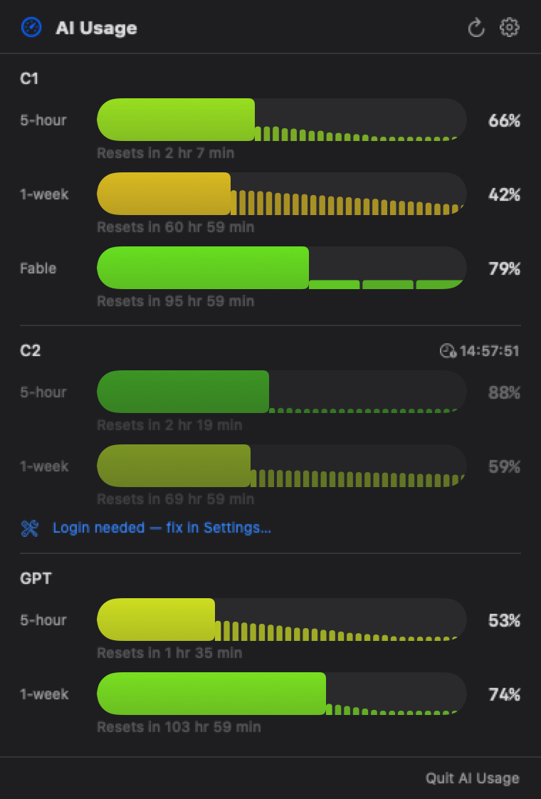
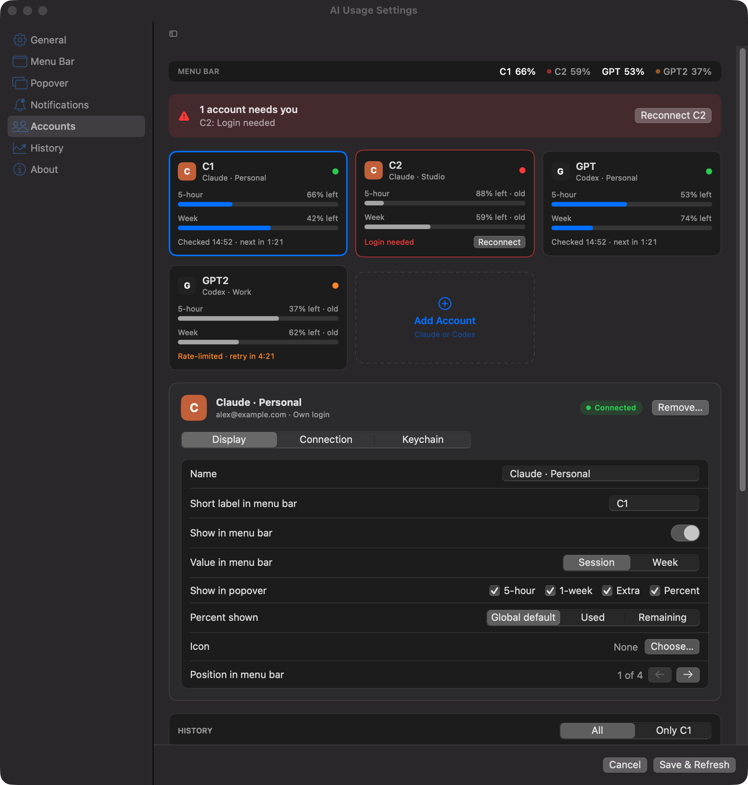
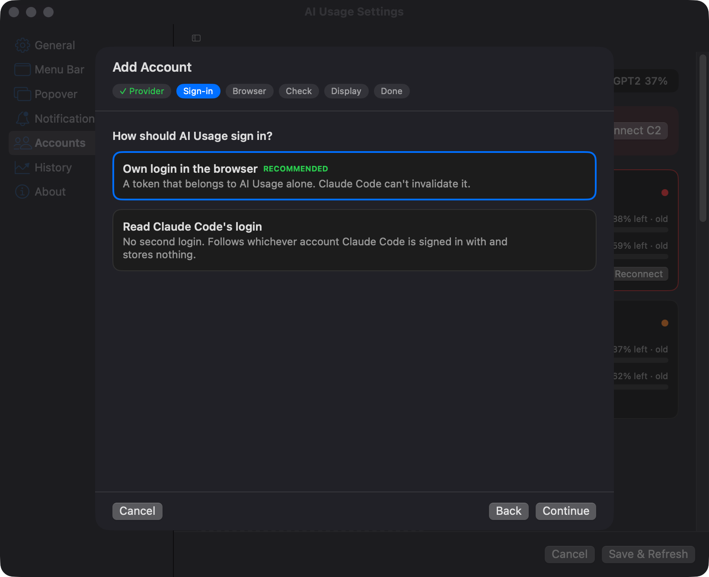
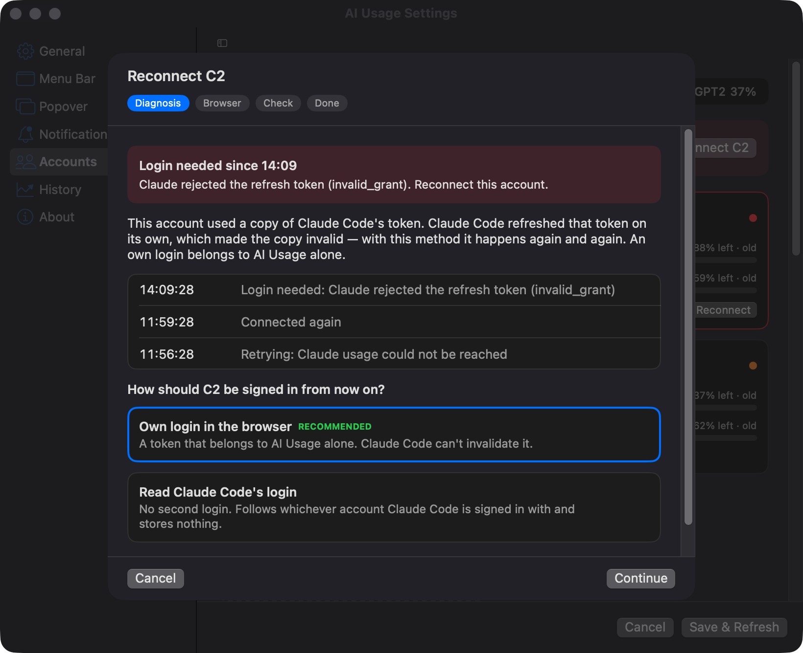

# AI Usage

A lightweight macOS menu bar app that shows your Claude and Codex quota at a glance — for as many accounts as you use.

Click the menu bar item to open a popover with per-account details, burn history and reset countdowns. Settings › Accounts shows every account as a card, explains what is wrong when a connection breaks, and walks you through adding or repairing accounts.

<div align="center">
  
  
</div>

<sub>All screenshots use made-up demo accounts and values.</sub>

## Requirements

- macOS 13 Ventura or later
- Swift 6 toolchain — the Xcode Command Line Tools are enough, no need for the full Xcode app:
  ```bash
  xcode-select --install
  ```
  (Full [Xcode](https://developer.apple.com/xcode/) or the [swift.org](https://swift.org/download/) toolchain also work.)
- **`claude`** — [Anthropic Claude Code](https://claude.ai/code), for Claude accounts (used for the browser sign-in)
- **`codex`** — [OpenAI Codex CLI](https://github.com/openai/codex), for Codex accounts (used for sign-in and reading usage)

You only need the CLI of the provider you add accounts for.

## Build & Run

```bash
git clone https://github.com/DominikVsetecka/ai-usage.git
cd ai-usage
swift run AIUsage
```

Build a release binary:

```bash
swift build -c release
# binary is at .build/release/AIUsage
```

Print current values without starting the menu bar app:

```bash
swift run AIUsageSnapshot
```

### Why build it yourself

There's no signed, notarized release binary to download — this is a small personal project, not a distributed product. The recommended way to run it is to build it locally with `swift run AIUsage` (above), which only needs the Swift toolchain from the Command Line Tools.

Building it yourself also sidesteps macOS Gatekeeper entirely: Gatekeeper only flags binaries that were *downloaded* (browser, AirDrop, etc.) and carry a quarantine flag. A binary you compile locally never gets that flag, so there's no "unidentified developer" warning to work around.

Once built, `.build/release/AIUsage` is a plain command-line executable (no `.app` bundle, so double-clicking won't launch it). To run it conveniently:

**Keep it in your PATH:**
```bash
cp .build/release/AIUsage /usr/local/bin/ai-usage
ai-usage        # run from anywhere
```

**Launch on login** — add a shell script to System Settings → General → Login Items:
```bash
#!/bin/bash
/usr/local/bin/ai-usage
```
Make it executable first: `chmod +x ~/ai-usage.sh`.

If you do copy the built binary to another Mac (e.g. via a network share), that copy also won't be quarantined — only files that traveled through a browser download or similar are. If macOS still warns about it, open System Settings → Privacy & Security and click **Allow Anyway**.

## Features

- **Any number of accounts** — add, remove and reorder Claude and Codex accounts; removing can be undone for 8 seconds
- **Guided wizard** — sign in through the browser with an own login (recommended) or read Claude Code's login live; picks a free Chrome profile, catches a wrong or already connected account, and saves nothing until a real usage check succeeds
- **Clear connection state** — network trouble, rate limits and a locked Keychain after wake heal on their own and keep the last value visible; only an expired login, a switched account or an incompatible CLI ask you to act, with a banner, a link in the popover and one clickable notification
- **Countdowns** — every account shows when it updates next, and a rate-limited account shows when it is asked again
- **Connection history** — logins, repairs, removals and state changes per account, stored locally
- **Keychain inventory** — what AI Usage stores, which item belongs to which account, and orphaned items you can delete; tokens are never shown, only their last four characters
- **Several Codex accounts** — every extra ChatGPT login gets its own Codex folder, your normal `~/.codex` stays untouched; Codex start options adapt to CLI updates automatically
- **Menu bar** — one value per account; configurable font size, weight and color mode (white / dimmed / usage gradient), live preview in Settings
- **Popover** — 5-hour, 1-week and (where reported) extra model-scoped quota windows per account, with a configurable "Visual" bar (time-remaining fill + burn history as blocks or a line), percentage and reset countdown
- **Per-account display** — name, short label, icon, menu bar value and which popover rows and percent style each account shows
- **Extra model-scoped quotas** — some plans report a separate weekly cap for a specific model (e.g. "Fable"); shown automatically for Claude accounts with an own login
- **Pace estimate** — optional "≈Xh Ym left at this pace" next to the 5-hour reset
- **Local usage history** — logged to `~/.ai-usage/history/YYYY-MM-DD.jsonl` on ≥1% change or every 30 min; 30-day retention; History tab with chart and per-series toggles
- **Custom icons** — pick any SVG or PNG per account; no brand logos are bundled
- **Configurable refresh** — 90 seconds / 2 minutes / 5 minutes

See [CHANGELOG.md](CHANGELOG.md) for release history.

## Configuration

All settings are editable in Settings (gear icon in the popover) and saved to `~/.ai-usage/config.json`. A fresh install starts without accounts; an older config with the fixed Claude 1 / Claude 2 / Codex slots is migrated once and keeps a `config.v1.json` backup.

### Adding an account

Open Settings › Accounts and click **Add Account**.

<div align="center">
  
</div>

**Claude**

- **Own login in the browser (recommended).** Pick the Chrome profile that is signed in to the account, confirm the e-mail and enable SSO if your company uses it. AI Usage runs Anthropic's official `claude auth login` in its own folder under `~/.ai-usage/claude-accounts/`, then keeps only that account's OAuth token in an app-owned Keychain item. Only AI Usage refreshes this token, so Claude Code, VS Code or Zed can never invalidate it. If the browser signs in a different account than the one you entered, nothing is saved.
- **Read Claude Code's login.** No second login: AI Usage reads Claude Code's credential on every check, stores nothing and never refreshes it. If you switch accounts in Claude Code, the account pauses with "Account changed" instead of showing someone else's numbers.

**Codex**

- **Sign in with ChatGPT in the browser.** AI Usage runs the official `codex login` with its own folder under `~/.ai-usage/codex-accounts/`, so you can add as many ChatGPT accounts as you like. If the browser reuses a session that is already connected, the wizard stops and offers a fresh sign-in — "Open in Private Chrome Window" avoids picking up an existing chatgpt.com session.
- **Use the Codex login on this Mac.** Reads the login your Codex CLI already uses (`~/.codex`).

Codex keeps and refreshes its own tokens; AI Usage only reads usage through `codex app-server`.

### When a connection breaks

<div align="center">
  
</div>

The card turns red, a banner names the account and the popover shows a "fix in Settings" link. **Reconnect** explains in plain words what happened — for example that an old import shared its token with Claude Code — and signs the account in again. Name, display settings and history stay as they are.

Accounts imported with an older version copied Claude Code's token. Claude Code and AI Usage then refresh the same token, and whichever refreshes first breaks the other. Such accounts are marked "Copy of Claude Code's login (legacy)"; **Switch to Own Login…** fixes it for good.

### Removing an account

**Remove…** lists what will be deleted (its Keychain item or its own Codex folder) and lets you keep the history. You can undo for 8 seconds. Claude Code's and Codex's own logins are never touched.

## Privacy

- No telemetry, no analytics. Network requests go only to Anthropic's usage and token endpoints for Claude accounts with an own login; Codex usage is read through your local Codex CLI
- Everything stays local under `~/.ai-usage/`: `config.json`, usage history (`history/`), connection history (`events.jsonl`), notification state, and the login folders under `claude-accounts/` and `codex-accounts/` — never inside the app bundle or this repository
- Claude tokens of own-login accounts are stored in app-owned Keychain items (service `app.ai-usage.claude-profile`, this Mac only, when unlocked); Claude Code's own Keychain item is never modified
- The connection history never contains tokens — at most a token's last four characters
- No account data, tokens or personal information are committed to this repository; the screenshots use demo data (`AI_USAGE_DEMO_FILE`)

## License

MIT

---

by [Dominik Vsetecka](https://github.com/DominikVsetecka)
